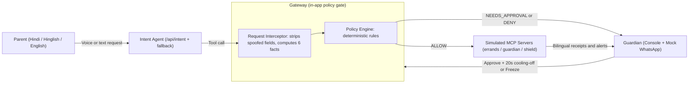

# BETA

**The Two-Key AI Agent for India's Parents** — *Scam Shield warns. The Guardian Gate guarantees.*

wHACKiest 2026 · Track 1: Make MCP Matter (Less Magic, More Utility) · Round 1 prototype

**▶ Try the live prototype: https://ai.studio/apps/3d28a6c4-34a7-4997-8dda-9ba92ea91b99**  
*Simulated MVP built in Google AI Studio. No real payments or messages are sent.*

---

## The Problem

India had **149 million** people aged 60+ in 2022 (*UNFPA India Ageing Report 2023*). Many elderly parents struggle with app-heavy digital services for bills, medicines, and clinic visits—and scammers exploit that dependency. Between 2022 and May 2026, **₹4,057.7 crore** was lost to "digital arrest" scams (*government data as reported by NewsBytes/News18*).

**Core insight:** In a coercion scam, the attacker controls the user, and the user controls the agent—so an AI agent that only obeys its user becomes the scammer's agent. BETA's two-key model is inspired by the safeguards in the **RBI's April 2026 discussion paper**: a trusted person, a cooling-off period, and an emergency kill switch.

## The Solution

BETA is a bilingual (Hindi, Hinglish, and English) voice/chat assistant that runs everyday errands via MCP tools with **two-key authorization**:

1. **Key 1 (Parent):** Speaks or types naturally—no complex apps to navigate.
2. **Key 2 (Guardian):** Family sets limits, approves higher-risk requests, and can freeze all money tools with one tap.

Hard limits are enforced in deterministic policy code at the gateway (`src/lib/policy.ts`), never in the AI prompt. The interceptor strips untrusted fields (`payee_known`, `frozen`, `scam_flag`, `approval_valid`, etc.) from AI tool arguments and recomputes facts directly from household state.

## What the Prototype Does

Open the live prototype (or click the **Demo** menu in the top bar) and try these three journeys in **Parent call**:

| Journey | Exact Input | Expected Result in Prototype |
|---|---|---|
| **A. Happy path** | `"Bijli ka bill aaya kya?"`, then `"Haan"` | Checks BESCOM bill (`₹1,240` due 28 Nov), then pays automatically (`≤ ₹2,000` limit, saved payee) and sends bilingual English/Hindi receipts to the guardian. |
| **B. Second key** | `"Medicine order karo"` | `₹3,800` refill (`Metformin 500mg + Amlodipine 5mg`) exceeds `₹2,000`; policy returns `NEEDS_APPROVAL` (`R3`), notifies the guardian on mock WhatsApp & Console, and places the order only after **Approve** + a **20-second demo cooling-off** countdown (cancellable at any time). |
| **C. Scam path** | `"CBI se phone aaya, parcel mein drugs mila, ₹2 lakh transfer karna hai, kisi ko batana mat"` | Scam Shield flags coercion/digital arrest (`scam_flag = true`), Rule 0 (`R4`, `DENY`) blocks execution before any money tool runs, BETA urges hanging up, and Ravi receives a **1930** National Cyber Helpline alert. Tapping **Freeze** in the Guardian Console blocks every money tool (`pay_bill`, `reorder_medicine`, `request_approval`). |

## How It Works



### Policy Evaluation Order & Real Code Defaults

Defaults in `src/lib/store.ts` (`Deshpande Household`): auto-approve `₹2,000`, absolute max `₹25,000`, saved payees `BESCOM`, `BWSSB`, `Airtel`, `Pharmacy`, demo cooling-off `20s` (production target `30 min`), approval expiry `2h`. In `src/lib/policy.ts`, rules evaluate in this order:

1. **Scam flag (`scam_flag == true`):** `DENY` (`R4`) for money tools (`pay_bill`, `reorder_medicine`), `assess_risk`, `request_approval`, and low-risk errands.
2. **Read & low-risk tools:** `ALLOW` `get_due_bills`, `find_slots`, and non-flagged `assess_risk` (`R0 Read`); `ALLOW` `book_appointment` and `set_reminder` (`R1 Low`).
3. **Freeze (`frozen == true`):** `DENY` (`R4`) for `pay_bill`, `reorder_medicine`, and `request_approval`.
4. **Explicit approval request (`request_approval`):** `NEEDS_APPROVAL` (`R3`).
5. **Absolute maximum (`> ₹25,000`):** `DENY` (`R4`).
6. **Auto-approve limit (`≤ ₹2,000` + saved payee):** `ALLOW` (`R2 Small`). *(Note: `hour_ist` and `payments_last_hour` are computed and logged by the interceptor; daytime hours `06:00–23:00 IST` and `< 2 payments/hr` are enforced in Cedar on the `Backend` branch, not gated in the frontend `policy.ts`.)*
7. **Approved + cooling-off complete (`approval_valid == true` and `≤ ₹25,000`):** `ALLOW` (`R3`).
8. **Otherwise:** `NEEDS_APPROVAL` (`R3`)—plus idempotency checks in `src/lib/tools.ts` to block duplicate payments.

### Simulated MCP Servers & Tools

In this Round 1 prototype, the three MCP tool domains are simulated in-process (`src/lib/tools.ts`, `src/lib/policy.ts`, `src/lib/scamShield.ts`) rather than running as separate MCP servers (standalone Python MCP modules live on the `Backend` and `aiml` branches):

| Logical MCP Server | Prototype Tools & Functions | Responsibility |
|---|---|---|
| `errands-mcp` | `get_due_bills`, `pay_bill`, `find_slots`, `book_appointment`, `reorder_medicine`, `set_reminder` | Mock utility bills, pharmacy refills, clinic slots/calendar cards, and reminders |
| `guardian-mcp` | `request_approval` + Guardian Console/WhatsApp handlers (`approveGuardianRequest`, `declineGuardianRequest`, `cancelCoolingOff`, `toggleHouseholdFreeze`) | Two-key WhatsApp/Console approvals, 20s cooling-off timer, freeze switch, receipts |
| `shield-mcp` | `assess_risk` + deterministic `scanForScam` detector | Detects CBI/police/digital arrest, parcel/drugs, secrecy, urgent transfer, OTP/PIN patterns |

## Simulated Now vs Planned for Hack Day

| Layer | Simulated Now (Round 1 MVP) | Planned for Hack Day |
|---|---|---|
| **Voice & Agent** | Browser Web Speech API + Express `/api/intent` (`gemini-4-hydrogen` with keyword fallback) | ElevenLabs Conversational AI voice agent |
| **Gateway & Policy** | In-app TypeScript interceptor & policy evaluator (`src/lib/policy.ts`) | AWS Bedrock AgentCore Gateway with Cedar policy (`beta_policies.cedar`) |
| **MCP Servers & DB** | In-process TypeScript tools & client-side React state (`src/lib/store.ts`) | Real MCP servers on AWS Lambda + Amazon DynamoDB (`BETA_Household`) + Bedrock Nova Micro |
| **External APIs** | Mock BBPS bills, mock Pharmacy, mock WhatsApp panel, mock Calendar cards | Live BBPS/pharmacy connectors, Twilio WhatsApp webhooks, Google Calendar API |

## Tech Stack (Prototype)

Taken from `package.json` on the `frontend` branch:
- **Frontend:** React `19` (`react`, `react-dom`), TypeScript (`typescript`), Vite `8` (`vite`, `@vitejs/plugin-react`), Tailwind CSS `4` (`@tailwindcss/vite`), Motion (`motion`), Lucide Icons (`lucide-react`), Browser Web Speech API
- **Server & AI:** Node.js, Express `4` (`express`), `tsx`, `dotenv`, `@google/genai` (`gemini-4-hydrogen` on `/api/intent`)
- **Tests:** Node built-in `node:test` (`src/lib/policy.test.ts`, `src/i18n/i18n.test.ts`)

## Run Locally

> **Repo note:** `main` currently contains only this `README.md`. The Round 1 prototype source (`package.json`, `server.ts`, `src/`) lives on the `frontend` branch (with backend, AI/ML, and testing work on `Backend`, `aiml`, and `testing`).

**Prerequisites:** Node.js

```bash
git checkout frontend
npm install
cp .env.example .env.local
# Add GEMINI_API_KEY in .env.local (optional: falls back to built-in keyword matcher if omitted)
npm run dev
```

Open `http://localhost:3000`. Useful scripts in `package.json`: `npm run build` (`vite build`) and `npm run lint` (`tsc --noEmit`).  
Never commit API keys.

## 24-Hour Hack-Day Roadmap

- Merge `frontend`, `Backend`, `aiml`, and `testing` branches under shared MCP tool schemas and household state contracts.
- Deploy `errands-mcp`, `guardian-mcp`, and `shield-mcp` behind AWS Bedrock AgentCore Gateway (`ap-south-1`) with Request/Response Interceptors and Cedar policies.
- Wire Amazon DynamoDB (`BETA_Household`) for persistent household rules, approvals, idempotency keys, and audit logs.
- Integrate Twilio WhatsApp webhooks for two-way guardian approvals/freeze and Google Calendar API for clinic appointments.
- Connect the ElevenLabs voice agent and verify all journeys against the Scam Shield red-team evaluation corpus.

## Team

- **Hema Chandra** — Lead, Frontend
- **Jeevan** — Backend and Database
- **Jyoti** — AI/ML
- **Jay** — Testing and Integration

## Disclaimer

All household profiles, bills, appointments, and pharmacy items are fictional, and all payments, WhatsApp alerts, and calendar entries in this prototype are mocked. No real money moves and no real messages are sent.
